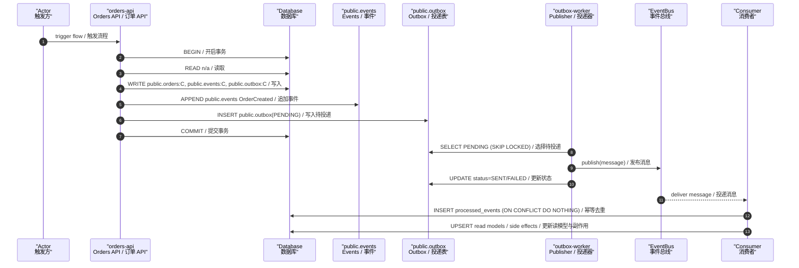

# FLOW-ORDER-CREATE-001 — Create Order / 创建订单

- **Owner**: `Orders API / 订单 API`
- **Reads**: n/a （读取表）
- **Writes**: public.orders:C, public.events:C, public.outbox:C （写入操作）
- **Events appended**: OrderCreated （追加事件）
- **Idempotency**: client_request_id （幂等键）

