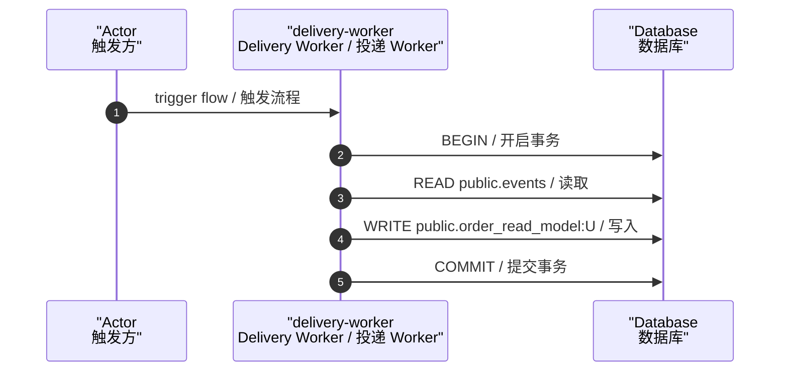

# FLOW-ORDER-PROJECTION-001 — Project Order Read Model / 投影订单读模型

- **Owner**: `Delivery Worker / 投递 Worker`
- **Reads**: public.events （读取表）
- **Writes**: public.order_read_model:U （写入操作）
- **Events appended**: n/a （追加事件）
- **Idempotency**: event_id （幂等键）

