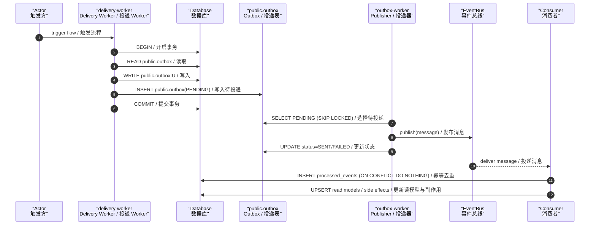

# FLOW-ORDER-PUBLISH-001 — Publish Order Event / 投递订单事件

- **Owner**: `Delivery Worker / 投递 Worker`
- **Reads**: public.outbox （读取表）
- **Writes**: public.outbox:U （写入操作）
- **Events appended**: n/a （追加事件）
- **Idempotency**: outbox_event_id （幂等键）

