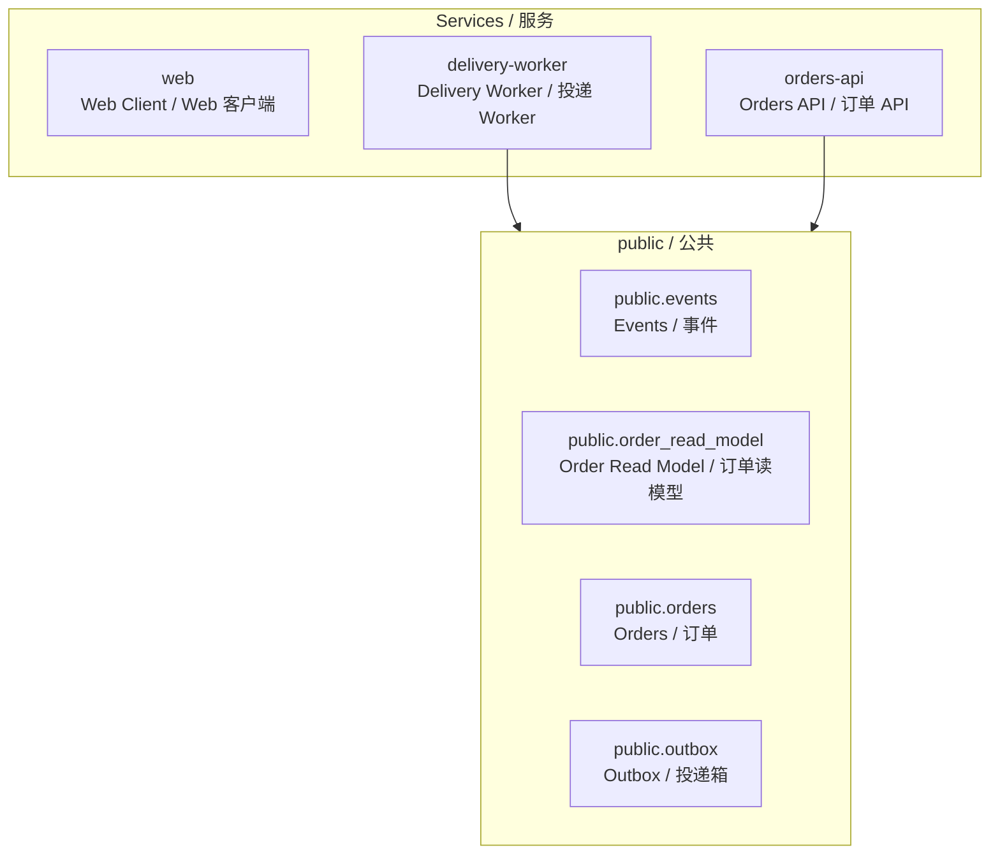

# L0 System Map（自动生成） / L0 系统地图（自动生成）

> 中文：这张图只表达“服务写入哪些 schema”，细节请查看 CRUD Matrix 和每条 Flow 的时序图。
> English: This diagram only shows "which service writes which schema". See the CRUD matrix and per-flow sequence diagrams for details.
